<!-- Generated art lives in assets/. Rebuild with: GITHUB_TOKEN=$(gh auth token) python3 scripts/build.py -->

<a href="https://omerarafat.com"></a>

&nbsp;
&nbsp;
&nbsp;

I'm a senior software engineer with 8+ years across the stack, from enterprise **identity and access management** to consumer marketplaces and multi-tenant SaaS. I've delivered client projects for teams in **Australia, Germany, the USA** and several other countries, working remotely from Dhaka. Today I work on Angular, Node.js, AWS and identity governance at **Allianz Australia**, and after hours I run **[ShareDeal](https://sharedealnow.com)**.

 

<picture>
  <source media="(prefers-color-scheme: dark)" srcset="assets/h-work-dark.svg"/>
  
</picture>

<a href="https://sharedealnow.com"></a>
<a href="https://github.com/arafatomer66/Gonok-Accounting"></a><a href="https://github.com/arafatomer66/openiga"></a>
<a href="https://github.com/arafatomer66/folio"></a><a href="https://github.com/arafatomer66/pulse"></a>
<a href="https://github.com/arafatomer66/garments-erp"></a><a href="https://github.com/arafatomer66/lattice"></a>
<a href="https://github.com/arafatomer66/shikkha-sms"></a><a href="https://github.com/arafatomer66/kiln-ui"></a>

 

<picture>
  <source media="(prefers-color-scheme: dark)" srcset="assets/h-stack-dark.svg"/>
  
</picture>


 

<picture>
  <source media="(prefers-color-scheme: dark)" srcset="assets/h-books-dark.svg"/>
  
</picture>

<a href="https://github.com/arafatomer66/llm-engineering-handbook"></a><a href="https://github.com/arafatomer66/mlops-for-developers"></a><a href="https://github.com/arafatomer66/learn-claude"></a>
<a href="https://github.com/arafatomer66/aws-for-devs"></a><a href="https://github.com/arafatomer66/cloudflare-for-devs"></a><a href="https://github.com/arafatomer66/networking-for-developers"></a>
<a href="https://github.com/arafatomer66/databases-compared"></a><a href="https://github.com/arafatomer66/go-developer-path"></a><a href="https://github.com/arafatomer66/iam-architect-roadmap"></a>
<a href="https://github.com/arafatomer66/gdpr-engineer-playbook"></a><a href="https://github.com/arafatomer66/senior-interview-prep"></a><a href="https://arafatomer66.github.io/scrum-zero-to-master/"></a>

 

<picture>
  <source media="(prefers-color-scheme: dark)" srcset="assets/h-pulse-dark.svg"/>
  
</picture>


 

<a href="https://www.linkedin.com/in/arafatomer66/"></a>
